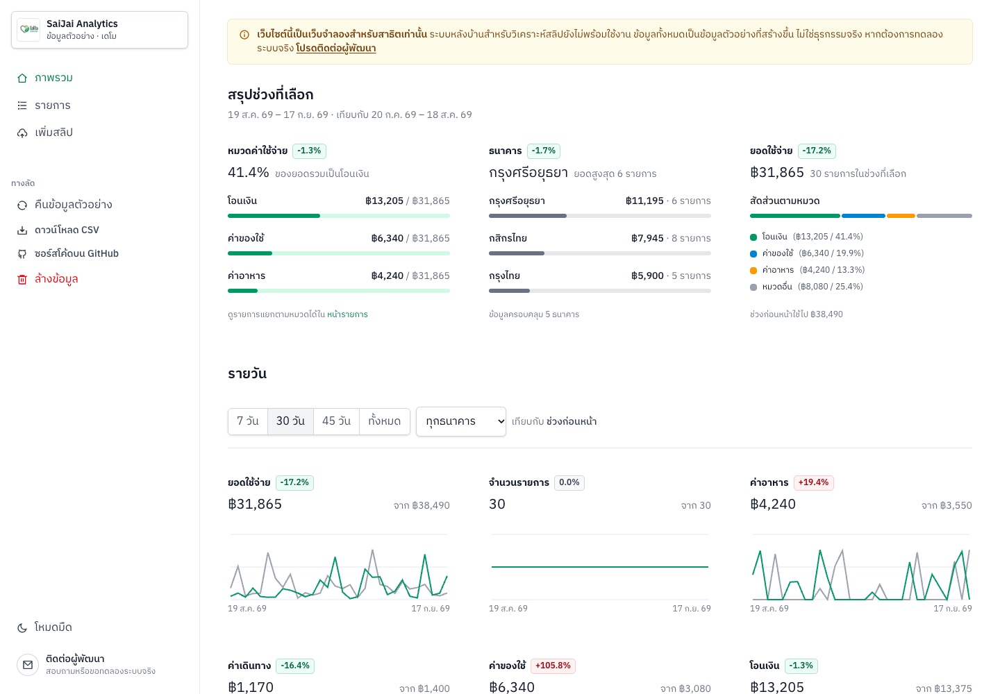
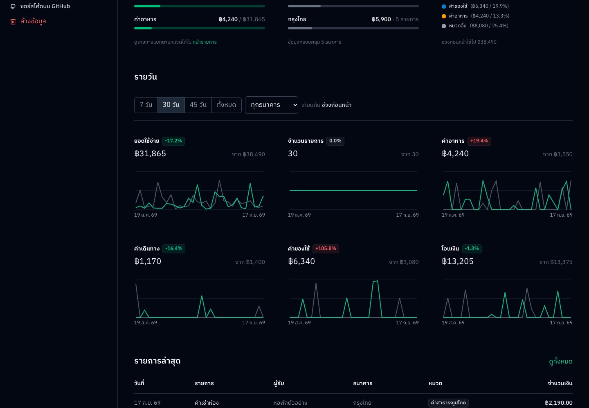
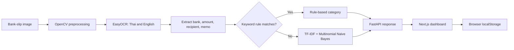

# SaiJai Analytics

SaiJai turns Thai bank-transfer slips into structured expense records and a spending dashboard. The backend reads each slip with OCR, extracts the bank, amount, recipient, and memo, and predicts an expense category. The web dashboard summarises the results by category, bank, and day.

**Live demo:** <https://saijaii.vercel.app>

> **Demo status.** The live site is a frontend-only demo. The slip-analysis backend is not deployed, so uploading a slip on the live site does not work, and the dashboard shows 100 synthetic sample transactions. To try the full system, run the backend locally (see [Getting started](#getting-started)) or [contact the developer](mailto:ariya06120@gmail.com?subject=SaiJai%20Analytics).

| Light mode | Dark mode |
| --- | --- |
|  |  |

## Features

### Dashboard

- **Period summary:** the top three categories and banks with progress bars, plus total spending with a stacked bar split by category
- **Period comparison:** choose the last 7, 30, or 45 days, and each figure is compared with the period just before it. A red badge means spending went up, and a green badge means it went down.
- **Daily charts:** six small line charts (total spending, number of transactions, food, transport, household items, and transfers) that show the current period against the previous one
- **Bank filter:** limit every figure and chart to one bank
- **Transactions table:** search by memo, recipient, bank, or reference, and filter by category
- **Light and dark mode:** follows the system setting by default, and the toggle remembers your choice
- Responsive layout: a sidebar on desktop, and top tabs on phones and tablets

### Slip analysis (backend)

- Accepts JPG, PNG, WebP, and HEIC images up to 10 MB
- Prepares images for OCR with OpenCV: grayscale, CLAHE contrast, denoising, and Otsu thresholding
- Reads Thai and English text with EasyOCR
- Extracts the bank, amount, recipient, and memo
- Classifies the expense into one of nine categories: keyword rules first, then TF-IDF with Multinomial Naive Bayes, and returns a confidence score

## How it works



Transactions are stored only in the user's browser (`localStorage`). No account or database is involved.

## Technology

| Area | Technologies |
| --- | --- |
| Frontend | Next.js 16, React 19, TypeScript, Tailwind CSS 4 |
| Charts and icons | Recharts, Remix Icon |
| Typeface | IBM Plex Sans Thai |
| Backend API | Python 3.10, FastAPI, Uvicorn |
| OCR | EasyOCR, OpenCV |
| NLP and ML | PyThaiNLP, scikit-learn (TF-IDF, Multinomial Naive Bayes) |
| Hosting | Vercel (frontend) |

## Sample data

The dashboard ships with 100 synthetic transactions dated 10 June to 17 September 2026, with 20 from each of five banks: Kasikornbank (KBank), Siam Commercial Bank (SCB), Krungthai (KTB), Bangkok Bank (BBL), and Krungsri (BAY). Each record has a date, bank, amount, memo, recipient, category, confidence score, and a synthetic reference.

> All sample records are synthetic. Names, references, and amounts do not represent real people or payments.

| File | Purpose |
| --- | --- |
| `data/slip_transactions.csv` | Source dataset |
| `frontend/data/sample-transactions.json` | Data loaded by the dashboard |
| `frontend/public/data/slip-transactions.csv` | CSV offered for download on the site |

Regenerate the data (the output is deterministic) with:

```bash
python3 data/generate_sample_data.py
```

## Getting started

### 1. Clone

```bash
git clone https://github.com/AriyaLuesawat/Project-saijai.git
cd Project-saijai
```

### 2. Backend

Python 3.10 is recommended. The first OCR request is slow while EasyOCR loads its models.

```bash
cd backend
python3 -m venv venv
source venv/bin/activate
python -m pip install --upgrade pip
python -m pip install -r requirements.txt
uvicorn main:app --reload --port 8000
```

Check that it runs at `http://localhost:8000/health`. Interactive API docs are at `http://localhost:8000/docs`.

### 3. Frontend

In another terminal:

```bash
cd frontend
npm ci
npm run dev
```

Open `http://localhost:3000`.

### Environment variables

Create `frontend/.env.local` to change the defaults:

| Variable | Default | Purpose |
| --- | --- | --- |
| `NEXT_PUBLIC_API_URL` | `http://localhost:8000` | Backend address used for slip uploads |
| `NEXT_PUBLIC_DEMO_MODE` | demo mode on | Set to `false` to hide the demo notice once a backend is available |

## API

### `GET /health`

```json
{ "status": "ok", "version": "2.0.0" }
```

### `POST /analyze-slip/`

Send `multipart/form-data` with one image in a field named `file`.

```json
{
  "status": "success",
  "data": {
    "bank_name": "KBank (Kasikornbank)",
    "amount": "250.00",
    "memo": "Lunch",
    "recipient": "Sample Restaurant",
    "category": "Food",
    "confidence": 1.0
  }
}
```

## Project structure

```text
Project-saijai/
├── backend/
│   ├── main.py                  # OCR, field extraction, classification, API
│   └── requirements.txt
├── data/
│   ├── generate_sample_data.py  # Deterministic sample-data generator
│   └── slip_transactions.csv
├── docs/screenshots/            # Images used in this README
├── frontend/
│   ├── app/
│   │   ├── globals.css          # Theme tokens and dark-mode variant
│   │   ├── layout.tsx           # Font, metadata, theme script
│   │   └── page.tsx             # Dashboard, transactions, upload
│   ├── data/sample-transactions.json
│   └── public/
├── licenses/                    # Third-party license texts
└── THIRD_PARTY_NOTICES.md
```

## Quality checks

```bash
cd frontend
npm run lint
npx tsc --noEmit
npm run build
```

## Limitations

- The live demo has no backend, so slip upload works only when you run the backend yourself.
- The category classifier uses a small built-in vocabulary and has not been evaluated on a labelled dataset.
- The amount extractor picks the largest number with two decimal places, which can be wrong on some slip layouts.
- Data lives only in the current browser and is lost when site data is cleared.
- OCR runs on the CPU, so response time depends on image size and hardware.
- The API allows all CORS origins, which should be restricted before production use.

## Roadmap

- Deploy the backend so the live demo can analyse real slips
- Add a database and user accounts
- Add anonymised OCR test fixtures and automated extraction tests
- Measure classification precision, recall, and F1 score
- Mask sensitive fields before storage or logging
- Add monthly reports and budgets

## Credits

The dashboard layout is adapted from Tremor's open-source [dashboard template](https://github.com/tremorlabs/template-dashboard-oss) (Apache-2.0). See [THIRD_PARTY_NOTICES.md](THIRD_PARTY_NOTICES.md).

## Author

**Ariya Luesawat**, Artificial Intelligence and Systems Engineering, Prince of Songkla University, Phuket Campus
[GitHub](https://github.com/AriyaLuesawat) · [LinkedIn](https://linkedin.com/in/ariya-luesawat-bb6280419)

## License

This project was created for coursework and experimentation with OCR, NLP, machine learning, and data visualisation. No open-source license has been chosen yet, so all rights are reserved by the author, except for the third-party components listed in [THIRD_PARTY_NOTICES.md](THIRD_PARTY_NOTICES.md).
